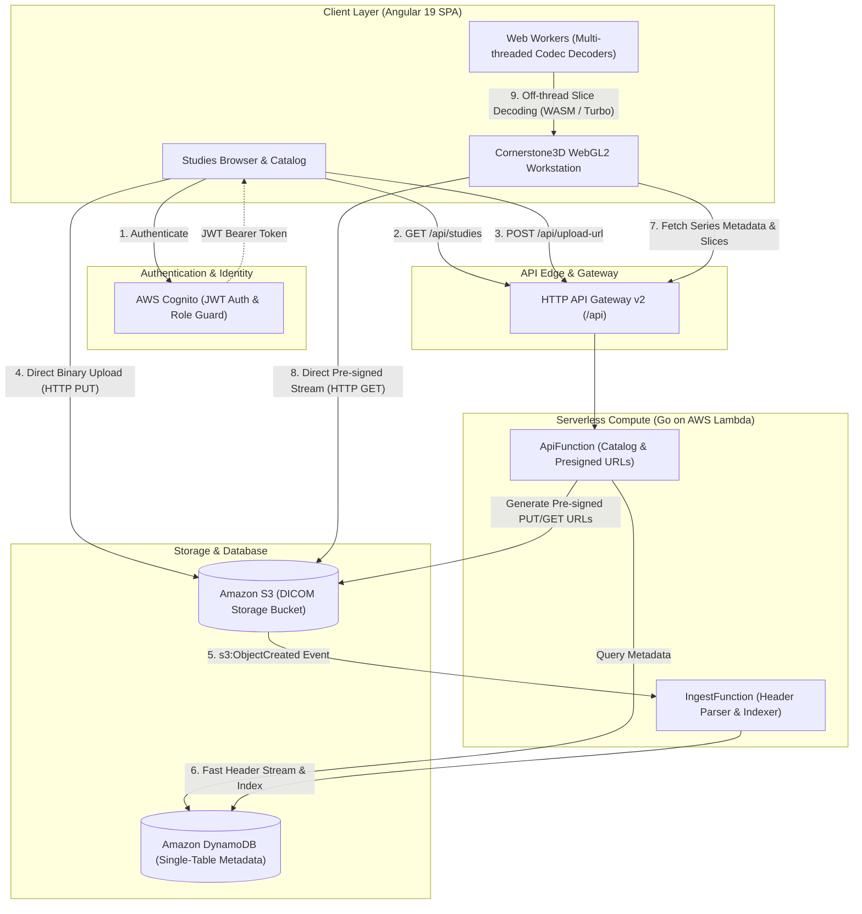

# Cloud-Native DICOM Platform

A full-stack, cloud-native medical imaging platform featuring an **Angular 19 + Cornerstone3D WebGL2** radiology workstation viewer and a high-performance **AWS Serverless Go** backend with DynamoDB single-table indexing and direct Amazon S3 streaming.

---

## Architecture Overview



---

## Core Capabilities

### 1. Radiology Workstation Viewer
- **WebGL2 Canvas Pipeline**: High-performance medical image rendering powered by `@cornerstonejs/core` and `@cornerstonejs/tools`.
- **Multi-threaded Web Worker Codecs**: Heavy slice decompression (JPEG Baseline 8/12-bit, JPEG 2000, JPEG-LS, Deflate) is executed off the main thread via Web Workers and WebAssembly binaries in `frontend/public/cornerstone-codecs/`.
- **Diagnostic Toolset**:
  - **Window / Level (Contrast)**: Interactive drag-based contrast adjustment with clinical Hounsfield Unit presets (*Soft Tissue, Lung, Bone, Brain, Stroke, Liver*).
  - **Pan & Zoom**: Hardware-accelerated smooth camera navigation with right-click zoom and middle-click pan.
  - **Calibrated Measurement**: Real-world distance measurement (mm) with active annotation overlay.
  - **Stack Navigation**: Volume scrubber slider, mouse wheel scrolling, and keyboard hotkeys (`↑` / `↓` for slices, `W` for W/L, `P` for Pan, `Z` for Zoom, `R` for Reset).
  - **Radiology HUD**: Viewport overlay displaying patient demographics, series metadata, zoom level, slice index, and GPU acceleration status.
  - **Local DICOM Support**: Drag-and-drop or instant file picker (`Open .dcm`) for offline inspection.

### 2. Studies Browser & Catalog
- **Live Search & Filtering**: Instant patient name and study UID filtering across modalities (CT, MR, XA, US).
- **Direct S3 Pre-signed Upload**: Two-step direct upload bypasses API Gateway payload limits, uploading files straight to S3 with live upload progress tracking and automatic DynamoDB catalog indexing.

### 3. Serverless Backend (Go on AWS Lambda)
- **High-Throughput Go Lambdas**: Compiled with `-tags lambda.norpc -ldflags="-s -w"` for sub-10ms cold starts on AWS Graviton / ARM64.
- **DynamoDB Single-Table Design**: Predictable sub-millisecond queries across Studies, Series, and Instances with a Global Secondary Index (`GSI1`) for patient lookup.
- **Zero Hardcoding**: All endpoints, buckets, and credentials dynamically injected via environment variables and CloudFormation parameters.

---

## Repository Structure

```
├── backend/
│   ├── lambdas/
│   │   ├── api/                  # API Gateway router, catalog queries, S3 presigned URLs
│   │   └── ingest/               # Fast streaming DICOM parser & DynamoDB indexer
│   ├── internal/
│   │   ├── models/               # Domain entities (Study, Series, Instance)
│   │   ├── parser/               # Streaming header reader with dicom.SkipPixelData()
│   │   └── repository/           # Single-table DynamoDB data access repository
│   ├── docs/
│   │   ├── openapi.yaml          # OpenAPI 3.1 specification
│   │   └── api/bruno/            # Ready-to-run Bruno HTTP API collection
│   ├── Makefile                  # Local emulation & SAM build automation
│   ├── template.yaml             # AWS SAM Infrastructure as Code (IaC)
│   └── local-env.json.example    # Local container environment configuration
├── frontend/
│   ├── public/
│   │   ├── cornerstone-codecs/   # WebAssembly decompression codecs
│   │   └── decodeImageFrameWorker.js # Standalone esbuild-bundled worker
│   ├── src/
│   │   ├── app/
│   │   │   ├── core/             # Services (Cornerstone, DICOM API, Auth) & Models
│   │   │   ├── features/
│   │   │   │   ├── studies/      # Studies Browser & Upload Catalog component
│   │   │   │   ├── viewer/       # Workstation Viewer, Toolbar & HUD components
│   │   │   │   └── auth/         # Login & Session Management component
│   │   │   └── shared/           # Header, navigation, and common layout UI
│   │   └── environments/         # Environment configuration (Local & Production)
│   ├── angular.json              # Angular 19 configuration with prebundle exclusions
│   └── package.json
└── README.md
```

---

## Quick Start (Local Development)

### Prerequisites
- **Docker** & **Docker Compose**
- **AWS SAM CLI** (`sam --version`)
- **Go 1.22+**
- **Node.js 20+** & **npm**

---

### Step 1: Start Local Backend Infrastructure

In terminal 1:

```bash
cd backend

# 1. Start Docker containers: DynamoDB Local (port 8000) & S3 Local (port 9090)
make local-db
make local-s3

# 2. Initialize DynamoDB single-table schema and S3 bucket
make local-db-init
make local-s3-init

# 3. Seed sample DICOM study metadata
make local-db-seed

# 4. Build and run the local SAM API (port 8080)
make local-api
```

---

### Step 2: Start Angular Frontend

In terminal 2:

```bash
cd frontend

# 1. Install dependencies
npm install

# 2. Start Angular dev server (port 4200, proxies /api calls to port 8080)
npm start
```

Open your browser at **[http://localhost:4200](http://localhost:4200)**:
- Navigate to **Studies Browser** to view indexed studies or upload `.dcm` files.
- Click **Open Viewer** or navigate to **Workstation Viewer** to inspect slices on the WebGL2 canvas.

---

## API Documentation & Contracts

- **[OpenAPI 3.1 Specification](file:///Users/admin/tech/code/for_works/dicom_viewer/backend/docs/openapi.yaml)**: Comprehensive API contract detailing request/response schemas for `/api/studies`, `/api/studies/{studyUid}/series`, `/api/studies/{studyUid}/series/{seriesUid}/instances`, `/api/upload-url`, and `/api/ingest`.
- **[Bruno API Collection](file:///Users/admin/tech/code/for_works/dicom_viewer/backend/docs/api/bruno)**: Pre-configured Bruno collections supporting both Local (`http://localhost:8080`) and Cloud environments.
- **[Backend Architecture Guide](file:///Users/admin/tech/code/for_works/dicom_viewer/backend/README.md)**: Detailed single-table partition key strategy, access patterns, and serverless architectural rationale.

