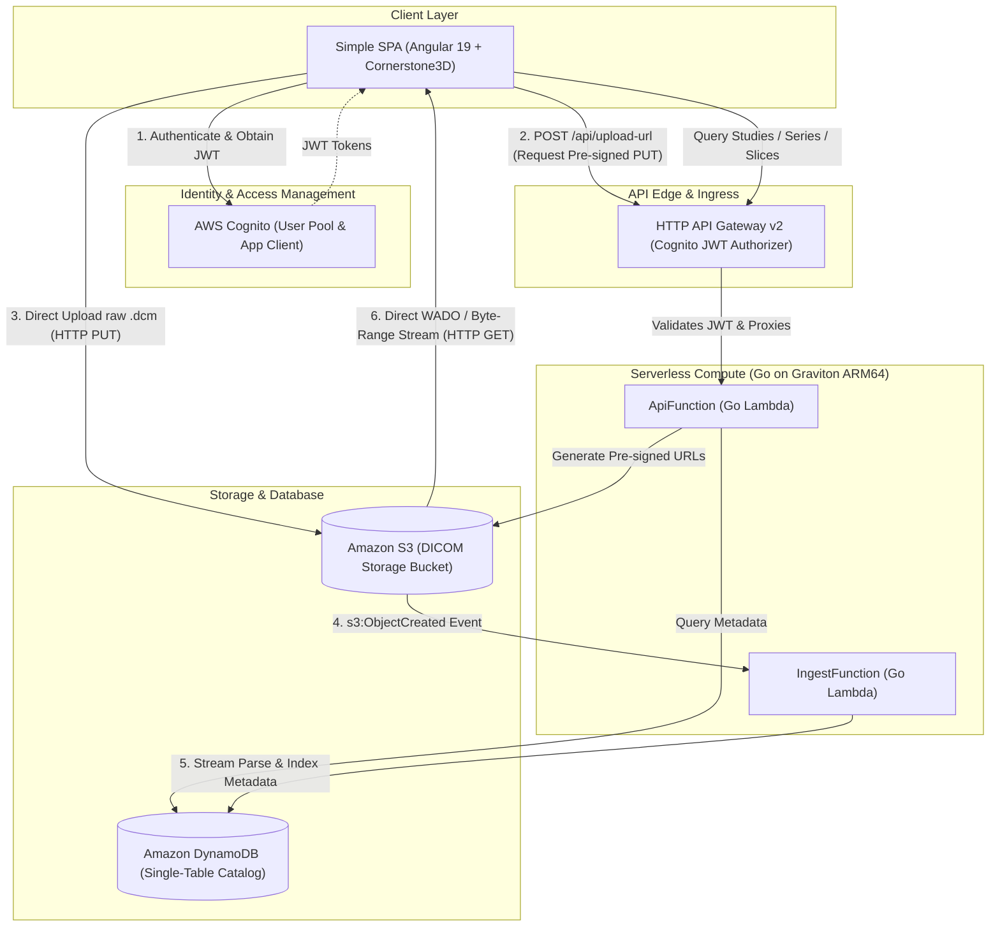

# DICOM Medical Imaging Platform — Serverless Backend

Cloud-native DICOM ingestion pipeline and metadata catalog service built on **AWS Serverless** with **Go (Golang)** running on **AWS Graviton (ARM64)**.

---

## 1. System Architecture



---

## 2. DynamoDB Single Table Design

All entities (Studies, Series, and Instances) are stored in a single table with on-demand capacity and a Global Secondary Index (`GSI1`) for patient queries.

| Entity | PK (Hash) | SK (Range) | GSI1PK (Hash) | GSI1SK (Range) | Attributes |
| :--- | :--- | :--- | :--- | :--- | :--- |
| **Study** | `STUDY#<StudyUID>` | `METADATA` | `PATIENT#<PatientID>` | `DATE#<StudyDate>` | `patientName`, `modalities`, `seriesCount`, `totalInstances` |
| **Series** | `STUDY#<StudyUID>` | `SERIES#<SeriesUID>` | — | — | `seriesNumber`, `modality`, `numberOfInstances`, `bodyPart` |
| **Instance** | `STUDY#<StudyUID>` | `INSTANCE#<SeriesUID>#<SOPUID>` | — | — | `instanceNumber`, `s3Key`, `rows`, `columns`, `windowCenter`, `windowWidth`, `rescaleSlope`, `rescaleIntercept` |

### Key Access Patterns:
1. **List Studies by Patient:** Query `GSI1` where `GSI1PK = PATIENT#<PatientID>` and `GSI1SK begins_with DATE#`.
2. **List All Studies:** Scan with filter `SK = METADATA`.
3. **Get Series for Study:** Query where `PK = STUDY#<StudyUID>` and `SK begins_with SERIES#`.
4. **Get Slices for Series:** Query where `PK = STUDY#<StudyUID>` and `SK begins_with INSTANCE#<SeriesUID>#`.

---

## 3. Directory Layout

```
backend/
├── lambdas/                  # Lambda entry points
│   ├── ingest/
│   │   └── main.go           # S3 ObjectCreated handler (pydicom/suyashkumar streaming)
│   └── api/
│       └── main.go           # HTTP API Gateway router & Pre-signed URL generator
├── internal/                 # Reusable domain and infrastructure packages
│   ├── models/
│   │   └── dicom.go          # Domain entities (Study, Series, Instance)
│   ├── parser/
│   │   ├── dicom.go          # Fast header streaming parser with dicom.SkipPixelData()
│   │   └── dicom_test.go     # Unit tests with in-memory DICOM datasets
│   └── repository/
│       └── dynamodb.go       # Single-table DynamoDB repository
├── api/
│   └── bruno/                # Git-friendly Bruno API collection
│       ├── bruno.json
│       ├── environments/     # Local & AWS environments
│       ├── studies/          # Studies, Series, Instances endpoints
│       └── ingestion/        # Upload URL & Direct S3 PUT
├── docs/
│   └── openapi.yaml          # OpenAPI 3.1 contract specification
├── Makefile                  # Build automation for SAM custom MakeBuilder
├── template.yaml             # AWS SAM Infrastructure as Code (IaC)
├── samconfig.toml            # SAM CLI deployment parameters
└── go.mod
```

---

## 4. Engineering Decisions & Best Practices

1. **Go on Graviton ARM64 (`provided.al2023`):**
   * **Cold Start:** 15–35 ms (compared to 600–1200 ms in Python with heavy medical packages).
   * **Cost:** 20% cheaper compute cost per millisecond on ARM64 compared to x86_64.
2. **Streaming DICOM Parsing (`dicom.SkipPixelData()`):**
   * Medical CT/MRI files can be 10 MB to 50 MB per slice.
   * `parser.ParseStream` uses `SkipPixelData()`, halting binary parsing right before pixel payload decoding. Lambda memory stays under **30 MB RAM**, even for multi-megabyte files.
3. **Direct S3 Pre-signed URLs:**
   * Heavy binary data never traverses the API Gateway or Lambda execution environments.
   * Uploads: Browser $\to$ S3 directly via Pre-signed PUT URL.
   * Viewer Streaming: Browser $\to$ S3 directly via Pre-signed GET URL with `Accept-Ranges: bytes`.
4. **Zero-Trust Edge Authentication:**
   * API Gateway HTTP API v2 natively validates AWS Cognito JWT tokens before triggering the Lambda function.

---

## 5. Development & Deployment

### Run Unit Tests
```bash
make test
# or: go test -v ./...
```

### Validate SAM Template
```bash
sam validate --lint
```

### Build Artifacts
```bash
sam build
```

### Local DynamoDB & SAM API Testing (Terminal Only, No GUI)

A complete local serverless environment is automated via `make` and Docker:

```bash
# 1. Start DynamoDB Local container on Docker network 'sam-network'
make local-db

# 2. Create the Single-Table schema (PK, SK, GSI1) via AWS CLI
make local-db-init

# 3. Seed test DICOM Study and Series data
make local-db-seed

# 4. Inspect data directly from the terminal
aws dynamodb scan --table-name hold-my-coffee-metadata --endpoint-url http://localhost:8000 --region us-east-2

# 5. Start SAM Local API connected to local DynamoDB
make local-api
# or: sam local start-api --docker-network sam-network --env-vars local-env.json --port 8080

# 6. Test endpoints via curl or Bruno
curl http://localhost:8080/api/studies
curl http://localhost:8080/api/studies/1.3.6.1.4.1.14519.5.2.1.7009.2403.334240657131972136850343327463/series

# 7. Stop DynamoDB Local when finished
make local-db-down
```

### Deploy to AWS
```bash
sam deploy --guided
```

### API Testing with Bruno
Open the `backend/api/bruno` folder in the [Bruno API Client](https://www.usebruno.com/):
* Select the `Local` or `AWS` environment.
* Execute requests in `studies/` and `ingestion/`.
* Or review the full API manifest in `backend/docs/openapi.yaml`.

